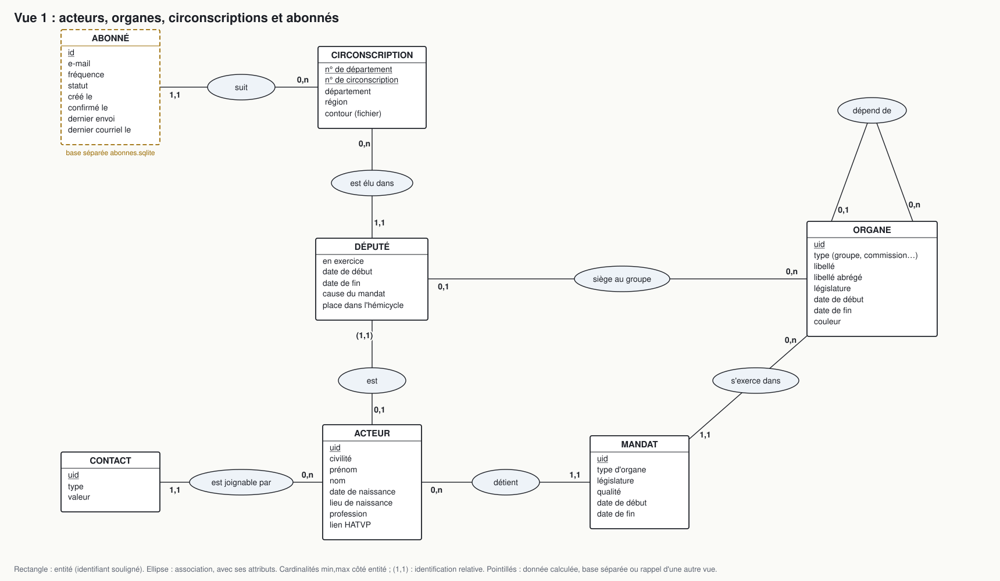
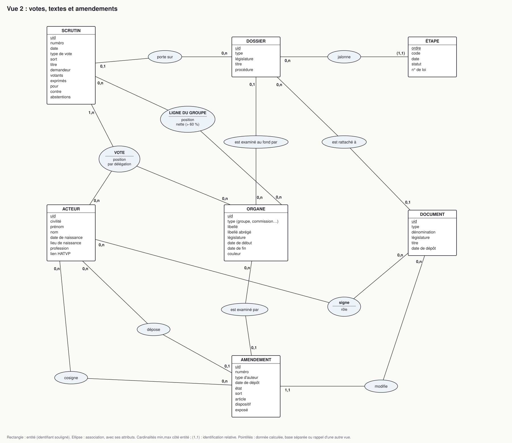
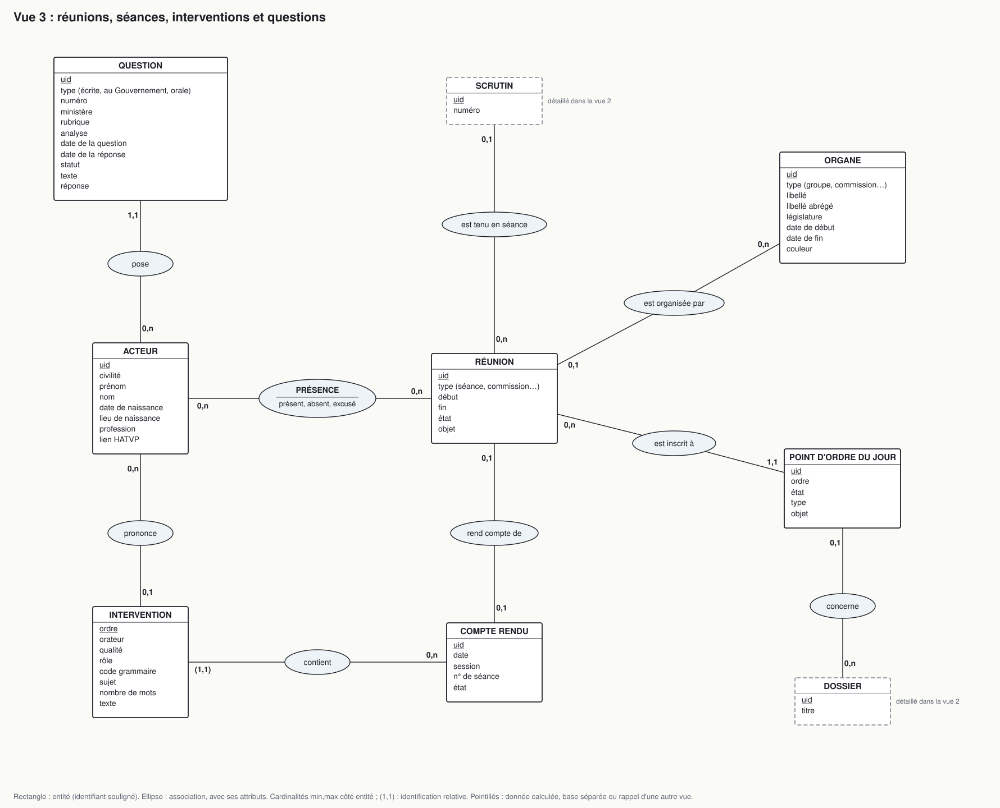
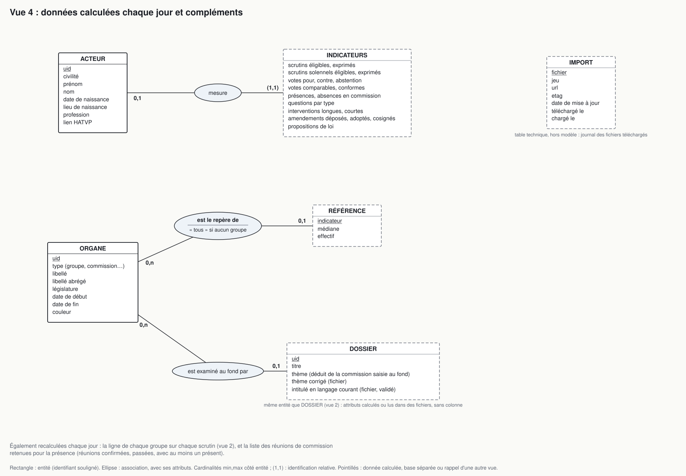

# Modèle conceptuel des données (MCD)

Notation Merise. Le modèle couvre les deux bases du projet :
`assemblee.sqlite` (données ouvertes de l'Assemblée et calculs, rechargée chaque
jour) et `abonnes.sqlite` (abonnés à la lettre, base séparée car elle contient
des données personnelles). Il est découpé en quatre vues ; ACTEUR, ORGANE et
DOSSIER reviennent dans plusieurs vues.

Les schémas sont produits par `python3 outils/generer_mcd.py`, à relancer (et à
mettre à jour) quand le schéma change dans `collecte/base.py`,
`collecte/indicateurs.py` ou `lettre/abonnes.py`.

Lecture : rectangle = entité, identifiant souligné ; ellipse = association,
avec ses attributs ; cardinalités « minimum,maximum » écrites côté entité ;
« (1,1) » = identification relative (l'entité n'est identifiée qu'avec celle
dont elle dépend) ; pointillés = donnée calculée, base séparée ou simple rappel.

## Vue 1 : acteurs, organes, circonscriptions et abonnés

## Vue 2 : votes, textes et amendements

## Vue 3 : réunions, séances, interventions et questions

## Vue 4 : données calculées et compléments

## Associations et leur traduction en tables

| Association | Cardinalités | Porté par (table.colonne) |
|---|---|---|
| ABONNÉ suit CIRCONSCRIPTION | 1,1 / 0,n | `abonnes.num_departement`, `num_circo` (pas de table des circonscriptions ; contours dans `collecte/contours/`) |
| DÉPUTÉ est élu dans CIRCONSCRIPTION | 1,1 / 0,n | `deputes.num_departement`, `num_circo` |
| ACTEUR est DÉPUTÉ | 0,1 / (1,1) | `deputes.acteur_uid` (une ligne par député de la législature, déduite de ses mandats) |
| DÉPUTÉ siège au groupe ORGANE | 0,1 / 0,n | `deputes.groupe_uid` (groupe actuel) |
| ACTEUR est joignable par CONTACT | 0,n / 1,1 | `contacts.acteur_uid` |
| ACTEUR détient MANDAT | 0,n / 1,1 | `mandats.acteur_uid` |
| MANDAT s'exerce dans ORGANE | 1,1 / 0,n | `mandats.organe_uid` |
| ORGANE dépend de ORGANE | 0,1 / 0,n | `organes.parent_uid` |
| VOTE (ACTEUR, SCRUTIN, ORGANE) | 0,n / 1,n / 0,n | table `votes` (position, par délégation ; groupe du député le jour du vote) |
| LIGNE DU GROUPE (SCRUTIN, ORGANE) | 0,n / 0,n | table calculée `lignes_groupe` (position, nette si > 60 %) |
| SCRUTIN porte sur DOSSIER | 0,1 / 0,n | `scrutins.dossier_uid` |
| SCRUTIN est tenu en séance RÉUNION | 0,1 / 0,n | `scrutins.seance_uid` |
| DOSSIER est examiné au fond par ORGANE | 0,1 / 0,n | `dossiers.commission_fond` |
| ÉTAPE jalonne DOSSIER | (1,1) / 0,n | table `etapes` (clé : dossier, ordre) |
| DOCUMENT est rattaché à DOSSIER | 0,1 / 0,n | `documents.dossier_uid` |
| ACTEUR signe DOCUMENT | 0,n / 0,n | table `documents_signataires` (rôle : auteur, cosignataire) |
| AMENDEMENT modifie DOCUMENT | 1,1 / 0,n | `amendements.texte_uid` |
| ACTEUR dépose AMENDEMENT | 0,n / 0,1 | `amendements.acteur_uid` (vide si l'auteur est le Gouvernement ou une commission) |
| ACTEUR cosigne AMENDEMENT | 0,n / 0,n | table `amendements_cosignataires` |
| AMENDEMENT est examiné par ORGANE | 0,1 / 0,n | `amendements.organe_uid` (aussi `groupe_uid`, groupe de l'auteur, non dessiné) |
| ACTEUR pose QUESTION | 0,n / 1,1 | `questions.acteur_uid` |
| PRÉSENCE (ACTEUR, RÉUNION) | 0,n / 0,n | table `presences` (présent, absent, excusé) |
| RÉUNION est organisée par ORGANE | 0,1 / 0,n | `reunions.organe_uid` |
| POINT D'ORDRE DU JOUR est inscrit à RÉUNION | 1,1 / 0,n | `points_odj.reunion_uid` |
| POINT D'ORDRE DU JOUR concerne DOSSIER | 0,1 / 0,n | `points_odj.dossier_uid` |
| COMPTE RENDU rend compte de RÉUNION | 0,1 / 0,1 | `comptes_rendus.seance_uid` et `reunions.compte_rendu_uid` |
| INTERVENTION est contenue dans COMPTE RENDU | (1,1) / 0,n | `interventions.compte_rendu_uid` (clé de fait : compte rendu, ordre) |
| ACTEUR prononce INTERVENTION | 0,n / 0,1 | `interventions.acteur_uid` (vide pour un orateur extérieur) |
| INDICATEURS mesure ACTEUR | (1,1) / 0,1 | table calculée `indicateurs` |
| RÉFÉRENCE est le repère de ORGANE | 0,1 / 0,n | table calculée `moyennes` (médianes ; périmètre « tous » ou un groupe) |

## Remarques

- Les identifiants viennent de l'Assemblée (`PA…` pour les acteurs, `PO…` pour
  les organes, `DLR…` pour les dossiers…), sauf ceux d'ABONNÉ et d'INTERVENTION.
  Le numéro interne d'une intervention change à chaque rechargement ; la clé
  stable est le couple (compte rendu, ordre).
- La base n'impose pas de clés étrangères : chaque jeu de données est rechargé
  en entier chaque jour, et certaines références pointent vers des objets absents
  des fichiers (organes anciens, textes d'une autre législature).
- Plusieurs informations ne sont pas dans la base mais dans des fichiers du code :
  les contours des circonscriptions (`collecte/contours/`), les corrections de
  thèmes (`collecte/themes_corrections.csv`) et les intitulés en langage courant
  (`collecte/libelles_textes.csv`). Le thème d'un dossier est calculé à la volée.
- Les tables `reunions_comptees` (réunions retenues pour la présence) et
  `imports` (fichiers téléchargés) sont techniques ; elles figurent dans la vue 4.
